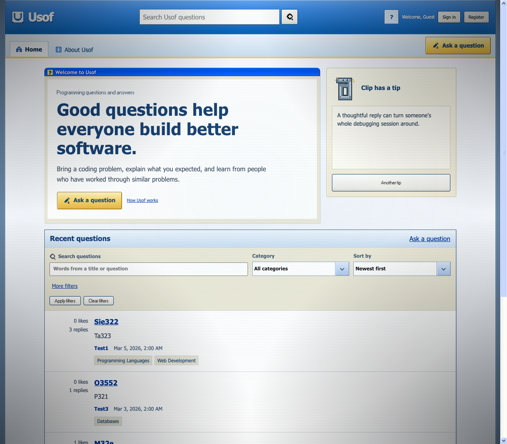
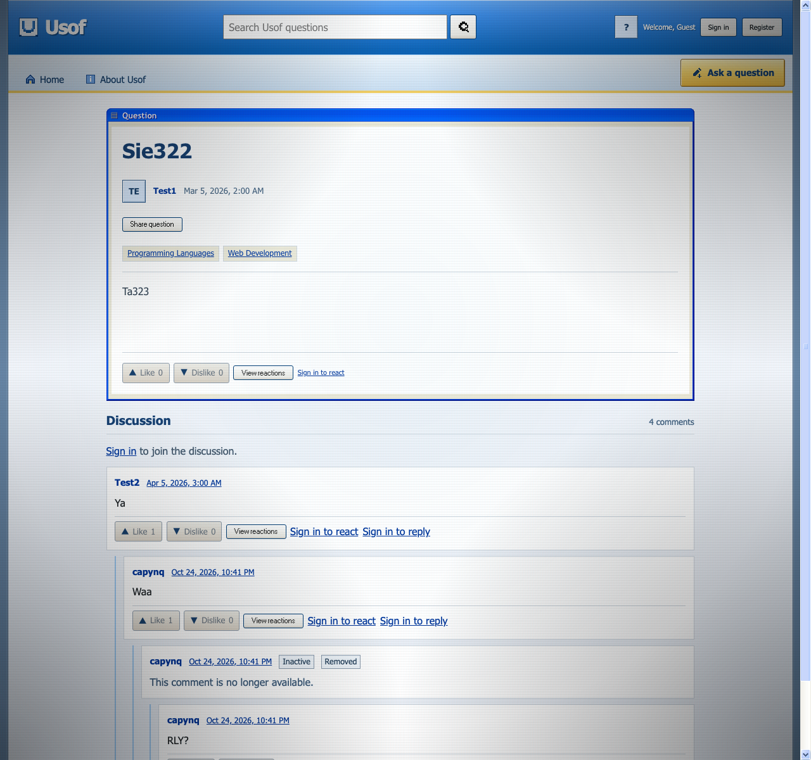

# Usof

Usof is a website for programming questions and answers. Users can post questions, write replies, react to posts and save favorites. They can also search, filter and sort questions, and edit their profiles. Admins can manage users, categories and content.

The frontend uses React, Redux Toolkit, React Router and xp.css. The backend uses Express and MySQL. The design is inspired by Windows XP.

## Screenshots





## Requirements

- Node.js 22.12 or newer
- npm 10 or newer
- MySQL 8.0.16 or newer

## Run locally

1. Clone the repository and open its folder.
2. Install dependencies and create the API configuration:

   ```bash
   npm install
   cp api/.env.example api/.env
   ```

3. Set the MySQL values, `AUTH_SECRET` (at least 32 characters), `WEB_BASE_URL=http://localhost:5173`, and an explicit `SEED_PASSWORD` in `api/.env` before seeding an empty database.
4. Create the database and seed data:

   ```bash
   npm run db:init
   ```

5. Start the API and frontend in separate terminals:

   ```bash
   npm run dev:api
   ```

   ```bash
   npm run dev:web
   ```

Open the address shown by Vite, usually `http://localhost:5173`.

The seeded admin account uses login `admin` and email `admin@example.test`; all seed accounts use the explicit `SEED_PASSWORD` value. The frontend admin panel is at `/manage`.

In local development, confirmation and password reset links are saved in JSON files in `api/storage/mail`. Open the link from the matching file in your browser.

## Build

```bash
npm run build
```

The frontend build is saved in `web/dist`.

## Documentation

[Frontend progress and program algorithm](web/docs/cbl.md) · [Backend setup and API](api/README.md)
