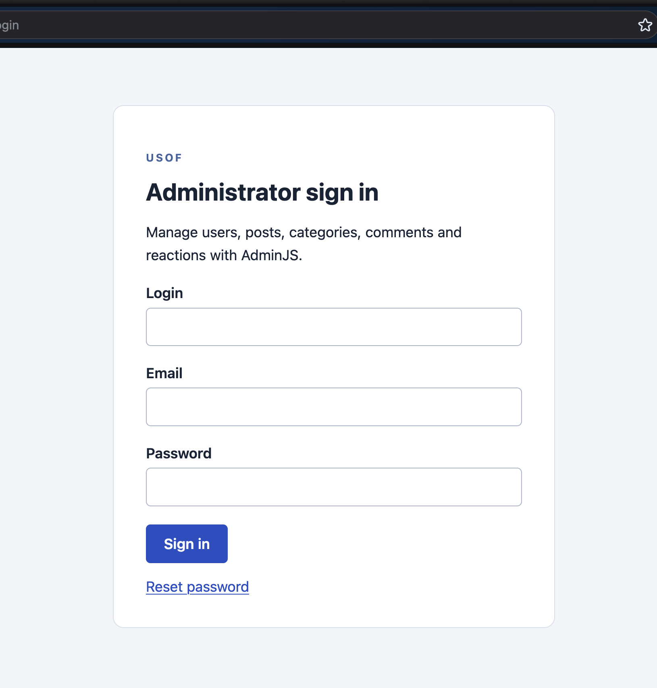

# Usof backend

An Express and MySQL backend for a programming-discussion service. It provides authentication, profiles and avatars, posts, categories, comments, reactions, ratings, moderation, and an [AdminJS](https://github.com/SoftwareBrothers/adminjs) panel.



CBL stage progress: [docs/cbl.md](docs/cbl.md).

## Stack and requirements

- Node.js 22+, npm, and MySQL 8.0.16+ with InnoDB and enforced `CHECK` constraints
- A MySQL account allowed to create the configured database and tables; `db:recreate` also needs permission to drop it
- Dependencies installed by `npm ci`: Express, AdminJS, `mysql2`, Multer, Nodemailer, and Valibot
- SMTP credentials for real mail delivery, or `MAIL_MODE=file` for local development

## Run locally

```bash
git clone ssh://git@git.green-lms.app:22022/challenge-667/nafanasiev-12105.git
npm ci
cp .env.example .env
```

Edit `.env`: set the database credentials, a private `AUTH_SECRET` of at least 32 characters, and `SEED_PASSWORD`. Then initialize and start the app:

```bash
npm run db:init
npm start
```

Open `http://localhost:3000/admin`. The exact origin must match `APP_BASE_URL`. `db:init` creates the database, schema, indexes, constraints, and seed data only when the users table is empty. It never drops existing data. To rebuild the configured reference database, use `npm run db:recreate`; it does not delete avatar files or the development mail outbox.

## Configuration

| Variable | Purpose |
| --- | --- |
| `NODE_ENV`, `PORT` | Environment and HTTP port (`3000` by default) |
| `DB_HOST`, `DB_PORT`, `DB_USER`, `DB_PASSWORD`, `DB_NAME` | MySQL connection; `DB_NAME` is `usof` or an allowed `usof_` name |
| `AUTH_SECRET` | Token-signing secret, at least 32 characters |
| `APP_BASE_URL` | Exact public origin, for example `http://localhost:3000` |
| `SMTP_HOST`, `SMTP_PORT`, `SMTP_USER`, `SMTP_PASSWORD`, `SMTP_FROM` | SMTP delivery settings |
| `MAIL_MODE` | `file` for local JSON outbox messages, or `smtp` |
| `SEED_PASSWORD` | Password assigned to all seed accounts |

Production requires `MAIL_MODE=smtp`. File mode writes private JSON messages to `storage/mail`; it does not send email.

## API and rules

All API routes start with `/api`. JSON requests reject unknown/protected fields; IDs must be positive integers. Successful responses are `{"data": ...}`; paginated lists additionally have `meta`; errors are `{"error":{"code":"...","message":"..."}}`. Logout and deletion return `204` with no body. Authenticated requests use `Authorization: Bearer TOKEN`.

| Area | Endpoints |
| --- | --- |
| Authentication | `POST /auth/register`, `GET /auth/email-confirm/:confirm_token`, `POST /auth/email-confirm`, `POST /auth/login`, `POST /auth/logout`, `POST /auth/password-reset`, `POST /auth/password-reset/:confirm_token` |
| Users | `GET /users`, `GET /users/:user_id`, `POST /users`, `PATCH /users/avatar`, `PATCH /users/:user_id`, `DELETE /users/:user_id` |
| Posts | `GET /posts`, `GET /posts/:post_id`, `POST /posts`, `PATCH /posts/:post_id`, `DELETE /posts/:post_id`, `GET /posts/:post_id/comments`, `GET /posts/:post_id/categories`, `GET`/`POST`/`DELETE /posts/:post_id/like`, `POST`/`DELETE /posts/:post_id/favorite` |
| Favorites | `GET /favorites`, `PUT`/`DELETE /favorites/:post_id` |
| Categories | `GET /categories`, `GET /categories/:category_id`, `GET /categories/:category_id/posts`, `POST /categories`, `PATCH /categories/:category_id`, `DELETE /categories/:category_id` |
| Comments | `GET /comments`, `GET /comments/:comment_id`, `POST /posts/:post_id/comments`, `PATCH /comments/:comment_id`, `DELETE /comments/:comment_id`, `GET`/`POST`/`DELETE /comments/:comment_id/like` |


- Guests can read active content. Authors can read their inactive posts; admins can read all inactive content. Inactive comments are admin-only, and hidden resources return `404`.
- Users create posts and comments on active posts and manage their own content. Admins manage categories, roles, visibility, and moderation, but cannot edit post titles/content or comment text.
- Posts accept 1–100 category IDs; titles are 1–200 characters and content is 1–50,000. Comments are 1–10,000 characters and immutable. Categories are unique, 1–100-character titles with optional 2,000-character descriptions.
- `GET /posts` supports `sort=likes|date`, category IDs, inclusive `date_from`/`date_to`, `status`, `page`, and `page_size`. Like sorting is descending by positive likes, then publication date and ID.
- One user may react once per post or comment. A duplicate reaction returns `409`; delete it before changing its type. Ratings equal received likes minus dislikes and are recalculated transactionally.
- Favorites are private to the authenticated user. `GET /favorites` is paginated with `page` and `page_size`; active posts are visible, plus the caller's own inactive posts. It accepts only those pagination parameters. Adding and removing a favorite are idempotent and return `204`.
- Avatars accept one JPEG, PNG, or WebP up to 2 MiB. Server-generated names are stored under `storage/avatars`; only controlled `/avatars/...` URLs reach MySQL.

## Admin and security

Open `/admin`; unauthenticated visitors go to `/admin/login`. Use the seeded `admin` account and `SEED_PASSWORD`. AdminJS exposes Users, Posts, Categories, Comments, and Reactions. Post moderation only changes categories/status; comment moderation only changes status.

The panel uses a signed, expiring, HttpOnly, SameSite=Strict cookie. Every request rechecks account existence, expiry, authentication version, and administrator role. Signing out invalidates that account's current tokens.

Passwords use `crypto.scrypt` with independent salts. Login names permit 3–40 letters, digits, underscores, or hyphens. Email confirmation links and password reset tokens use random 32-byte values, store only SHA-256 hashes, expire after one hour, and are single-use. Reset emails give the token and the `POST /api/auth/password-reset/:confirm_token` endpoint; the client supplies `new_password`. Password reset or email change invalidates relevant sessions and tokens.
